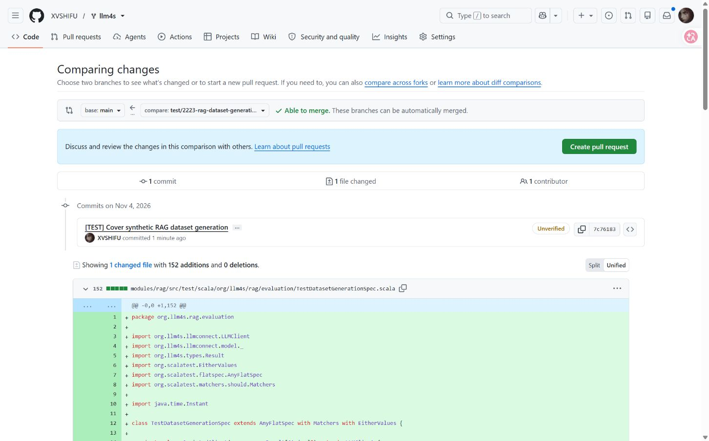

# llm4s #2223 — validation evidence

Implementation: https://github.com/XVSHIFU/llm4s/compare/main...test/2223-rag-dataset-generation

Published commit: `7c76183d098c7a6ab522c762a8ad455776bbad33`.
Tested and published tree: `d1479ede6e8d0b91b1ef4f1556b90830f0b6ee03`.

One new test file, 152 lines, eight deterministic offline tests. No production changes.

## Validation

- New suite: 8 passed.
- RAG module: 2,144 passed across 122 suites; one existing canceled experimental-stub test and one existing pending known-limitation test.
- scalafmtAll, scalafixAll, scalafmtCheckAll: passed.
- Mutation check replacing extractJsonArray with identity: two expected failures, six passed. Production source restored byte-for-byte before the passing RAG run.
- git diff --check: passed.
- Independent review completed with no blockers.
- Full repository sbt test was not run.

## Publication status

The implementation is published on the user's fork. No upstream PR has been opened yet.
The contribution commit has no Signed-off-by trailer; the human contributor must personally review and certify the DCO before upstream submission.
See https://github.com/llm4s/llm4s/blob/main/CLAUDE.md#commits.

PR-body.md is a prepared draft, not an already submitted PR.
The evidence branch is separate from the contribution branch and is not intended for the upstream PR.

